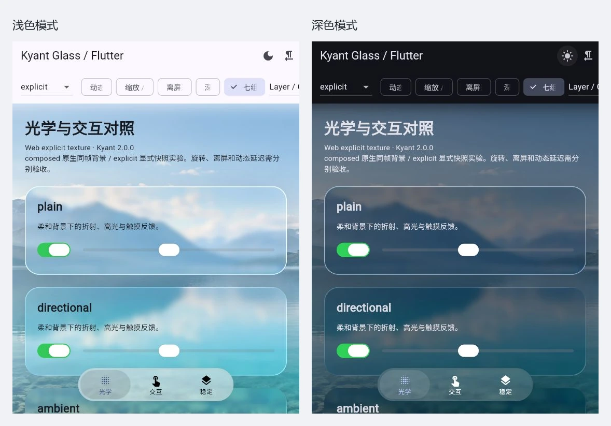

# 液态玻璃 Flutter

基于 [Kyant Backdrop 2.0.0](https://github.com/Kyant0/AndroidLiquidGlass/tree/2.0.0) 移植的 Flutter 液态玻璃库，提供背景折射、模糊、色散、高光和柔性控件。我们将原版光学与交互带到 Dart / GLSL，并适配 Flutter 的背景采样与动画链路。

| 效果与组件 | 说明 |
|---|---|
| 液态玻璃表面 | 圆角折射、厚度与深度、七组色散、背景高斯和颜色处理 |
| 高光与阴影 | Plain、Directional、Ambient 高光，以及独立的内外阴影 |
| `LiquidButton` | 按压时柔性放大，释放时弹簧回落，指针移动带动高光 |
| `LiquidToggle` | 玻璃滑块随开关状态移动，拖动和按压产生弹性形变 |
| `LiquidSlider` | 连续调节数值，带阻尼拖动与滑块形变 |
| `LiquidBottomTabs` | 底部玻璃外壳与移动透镜，支持拖动切换和 RTL 布局 |
| 背景输入 | Layer、Canvas、Combined、Empty 与 Transformed 采样域 |
| Flutter 扩展 | 渐变模糊、Shader 预热、独立画廊、帧耗时诊断与 CI |

玻璃的质感来自它与背后内容的关系。文字与色块穿过边缘时发生折射，光线沿着圆角流动，手指按下时，控件像有重量一样轻轻展开，再随着弹簧回到原位。我们希望把这种视觉和触感带到 Flutter，让玻璃既能成为页面的一部分，也能成为可触摸、可拖动的交互组件。

本项目基于 **[Kyant](https://github.com/Kyant0)** 的 [AndroidLiquidGlass / Backdrop 2.0.0](https://github.com/Kyant0/AndroidLiquidGlass/tree/2.0.0) 移植。原版是一套面向 Compose Multiplatform 的可自定义液态玻璃效果库，Catalog 中展示了按钮、开关、滑块和底部标签的交互设计。这里将它们改编为 Dart 与 GLSL，并围绕 Flutter 的绘制、背景采样和动画方式重新组织实现。

当前包名为 `kyant_glass`，版本 `0.2.0-dev.1`。组件直接沿用原版的 `LiquidButton`、`LiquidToggle`、`LiquidSlider`、`LiquidBottomTabs` 名称。

## 文档

[使用指南](docs/USAGE.md) 介绍背景源、效果链、控件参数和诊断接口；[渲染说明](docs/RENDERING.md) 解释原生滤镜与显式图像采样的区别，以及坐标、变换和渐变模糊的处理。上游算法与本项目源码的对应关系整理在 [来源与改编](docs/SOURCES.md)，原版效果的设计介绍可阅读 [Kyant 文档](https://kyant.gitbook.io/backdrop)。

## 演示

仓库提供独立的 Android / Web 画廊，使用 AI 生成的简洁山湖风景作为背景。画廊可以切换明暗主题、RTL 和动态背景，调节色散、深度与渐变模糊，并比较不同背景输入和渲染路径。Button、Toggle、Slider 与 BottomTabs 都可直接操作，便于观察按压、拖动和释放时的表现。



展示图来自实际运行的 Flutter Web 画廊，玻璃与控件均由本库渲染。

使用 **Flutter 3.47.5 / Dart 3.13.4**，Android 构建使用 **JDK 17**：

```sh
git clone https://github.com/xiaomanjun233/liquid-glass-flutter.git
cd liquid-glass-flutter/example
flutter pub get
flutter run
```

运行 Web 画廊使用 `flutter run -d chrome`。示例代码位于 [`example/lib/main.dart`](example/lib/main.dart)，可以从中查看背景源与玻璃控件的完整组合。

## 接入 Flutter

在应用的 `pubspec.yaml` 中加入 Git 依赖。`ref` 可以使用 `main`，也可以换成具体提交 SHA 来固定版本：

```yaml
dependencies:
  kyant_glass:
    git:
      url: https://github.com/xiaomanjun233/liquid-glass-flutter.git
      ref: main
      path: packages/kyant_glass
```

原生环境中，玻璃可以采样已经绘制的背景。启动时预热 Shader，再将组件叠在内容上方：

```dart
import 'package:flutter/material.dart';
import 'package:kyant_glass/kyant_glass.dart';

Future<void> main() async {
  WidgetsFlutterBinding.ensureInitialized();
  await KyantGlass.precache();
  runApp(const MaterialApp(home: GlassDemo()));
}

class GlassDemo extends StatelessWidget {
  const GlassDemo({super.key});

  @override
  Widget build(BuildContext context) => Scaffold(
    body: Stack(
      fit: StackFit.expand,
      children: [
        const DecoratedBox(
          decoration: BoxDecoration(
            gradient: LinearGradient(
              colors: [Color(0xFF3557CE), Color(0xFFFFA66E)],
            ),
          ),
        ),
        Center(
          child: LiquidButton(
            onPressed: () {},
            child: const Text('液态玻璃'),
          ),
        ),
      ],
    ),
  );
}
```

需要自定义材质时使用 `KyantGlass`。它提供圆角、模糊、折射高度与强度、色散、染色、高光和阴影参数，也接受有序 `effects` 列表。可以先调整背景颜色与 vibrancy，再进行高斯处理和折射。Web 通过 `KyantBackdropSource` 提供明确的背景图像，生产者与消费者放在兄弟分支；页面释放时销毁创建的 Controller。完整代码见 [使用指南](docs/USAGE.md)。

## 模糊与采样链路

| 场景 | 输入 | 模糊与折射方式 |
|---|---|---|
| 原生 `composed` | 已绘制的后景 | `BackdropFilterLayer` 承接输入，`ImageFilter.compose` 按顺序组合颜色处理、`ImageFilter.blur` 与 `ImageFilter.shader` |
| 原生 `legacy` | 已绘制的后景 | 各效果使用分离的背景滤镜，便于和复合路径对照 |
| Web / `explicit` | `KyantBackdropSource` 的背景图像 | `OffsetLayer.toImageSync` 捕获局部输入，经坐标映射和效果处理，由 `FragmentShader.setImageSampler` 交给透镜 Shader |
| 渐变模糊 | 后景或显式图像 | 共享背景的分段高斯，或多层高斯配合连续遮罩 / 插值 |

高斯采用 Flutter 的 `dart:ui ImageFilter.blur`，边缘使用 `TileMode.clamp`，滤镜交给 Flutter 渲染器处理。原生默认链把颜色处理、高斯和透镜依次组合；自定义 `effects` 按传入顺序执行。原生 Shader ImageFilter 是否可用，由运行时能力查询决定，复合链的实际 GPU pass 数量由引擎安排。

Web 的折射输入来自明确的背景源。背景绘制后生成 `ui.Image`，消费者根据背景到全局、全局到局部的矩阵定位内容，先为高斯半径和透镜位移预留采样边距，再顺序处理效果。透镜通过 `sampler2D` 读取图像，七组色散沿不同波段偏移采样；库不逐帧编码 PNG，也不在 Dart 中逐像素计算模糊；但 `toImageSync` 是否包含引擎内部读回取决于 Web 渲染器，不能保证纯 GPU / 零拷贝。

背景版本、表面尺寸或采样变换变化时，显式结果才会重算；连续基础滤镜合成一次图像处理，末尾透镜直接绘制；旧图像按生命周期释放。静止内容保留，触摸动画主要更新玻璃形状和材质。原生层在场景合成时绑定几何，因此仅发生合成层移动的场景也能更新采样矩阵。显式图像在绘制后更新，快速动态背景需要结合采样时序观察效果。

渐变模糊扩展沿用同一套高斯滤镜，`shared` 复用同源输入；`layered` 用较少高斯层叠加连续遮罩；`interpolated` 从显式背景混合四级高斯。后两种通过近似中段分布减少滤镜组，层数可在画廊中比较。

## 我们为 Flutter 做了什么

光学部分以 Kyant 2.0.0 为基线。我们将原版 AGSL 中的圆角距离场、折射、深度、七组色散和高光改编为 Flutter GLSL / sampler2D，并加入 Flutter 坐标与 GLES 纹理方向适配。色散开启时保留七组采样，关闭时走等效单采样；四个角分别传入半径，高光则由 Shader 绘制。

背景采样是两种 UI 框架之间最主要的适配工作。我们用 Flutter 的背景滤镜和显式图像建立了两条输入链路，管理背景域、原点、变换矩阵和图像生命周期。Layer、Canvas、Combined、Empty 与 Transformed 接口让应用按场景组织背景；BottomTabs 保留外壳与内部移动透镜的绘制顺序，使内部透镜能够看到已绘制的外壳和标签。

效果链接入 Flutter 的颜色处理、高斯和 Shader ImageFilter，并提供复合滤镜、分离滤镜与显式图像三条路径用于对照。原生路径直接消费已绘制背景；显式路径在绘制后更新背景图像，适用于 Web 与需要明确采样域的场景。Shader 程序在启动时预热并缓存，每个表面持有自己的 Shader 实例，稳定内容保留，动画主要更新几何与材质参数。

交互部分将 Catalog 的按压、指针高光、弹簧形变与阻尼拖动接入 Flutter 的指针和动画系统。按钮、开关、滑块和底部标签同时处理释放、取消与中途打断，并加入键盘和语义支持。公共组件名称与原版 Catalog 保持一致。

在核心移植之外，我们增加了渐变模糊和帧耗时诊断。渐变模糊可以比较共享输入的分段高斯与较少层数的插值 / 遮罩，在视觉分布和渲染成本之间选择；诊断按一次操作收集 build / raster 分位数，采样过程不逐帧重建面板。库、画廊和测试独立组织，应用通过依赖接入。具体渲染能力与平台状态见 [渲染说明](docs/RENDERING.md)。

## 开发

库和示例分别执行分析与测试，示例构建负责验证实际 Shader 编译：

```sh
cd packages/kyant_glass
flutter pub get
flutter analyze
flutter test
cd ../../example
flutter pub get
flutter analyze
flutter test
flutter build web --release
flutter build apk --release --target-platform android-arm64
```

CI 执行同样的检查。使用 `flutter run --profile --dart-define=KYANT_BENCHMARK=true` 开启画廊诊断，贡献方式见 [贡献指南](CONTRIBUTING.md)。

## 作者与许可

原始液态玻璃算法与 Catalog 交互由 **Kyant** 创作，Copyright 2025 Kyant。Flutter 移植与扩展由 [xiaomanjun233](https://github.com/xiaomanjun233) 及贡献者维护。

项目采用 **Apache License 2.0**。上游许可证原文保存在 [LICENSE](LICENSE)，作者与修改声明见 [NOTICE](NOTICE)，详细来源见 [SOURCES](docs/SOURCES.md)。Flutter 模板许可见 [THIRD_PARTY_NOTICES](THIRD_PARTY_NOTICES)。
